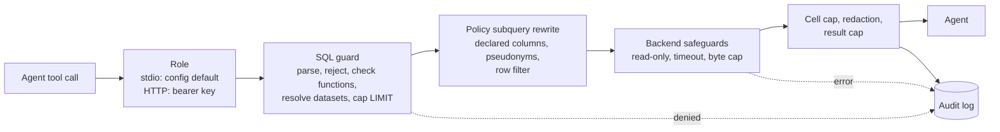

# System architecture

Code owns the mechanics; this page owns the reasons and the map. Entry points:
`src/warehouse_mcp/service.py` (policy path), `sql_guard.py` (rewrite), `server.py` (MCP tools).

## Request path

`WarehouseService._execute` runs this path for `warehouse_run_sql` and `warehouse_query_metrics`.
Metrics requests are compiled to SQL by `semantic.py` as a syntax tree (filter values are literals),
then go through the same guard, so policy applies identically to both tools. The MCP layer
(`server.py`) only maps tools onto service methods, so stdio, HTTP and tests share one policy path.

## Why pseudonymize at the source

The alternative is column lineage masking: let the query run, then mask output columns that trace
back to PII. We rejected it as the primary control for three reasons.

| Property | Pseudonymize in the policy subquery | Mask on the way out |
|----------|--------------------------------------|---------------------|
| `count(DISTINCT editor)`, `GROUP BY editor`, joins on editor | Exact: equal names give equal pseudonyms | Break or leak: masked output cannot be re-aggregated |
| Name never leaves the warehouse | Yes, even in error messages (`CAST(editor AS INTEGER)` shows the pseudonym) | Only if lineage is complete; derived columns (`upper(editor)`, `md5(editor)`, `string_agg`) are the hard cases |
| Probe `WHERE editor = 'Alice'` | Matches nothing: the predicate compares against pseudonyms | Matches: row presence is an oracle |
| Lineage engine needed | No | Yes, per dialect |

Mechanics: every dataset reference becomes `(SELECT <declared columns, pii ones as pseudonym>
FROM <table> WHERE <role row filter>) AS <alias>`. The pseudonym is `pii_` plus 12 hex chars of
`MD5(salt || value)`. The salt comes from `WAREHOUSE_MCP_PII_SALT` (16-128 letters or digits) or is
random per process, so pseudonyms cannot be precomputed from a list of usernames. The salt only
appears in the physical SQL, which is never logged or returned (`GuardedQuery.logical_sql`).

Trade-off accepted: masking only covers columns the model tags. Names typed into free text are not
caught by column tags; that is the narrow redaction net below, and column lineage for it is on the
[roadmap](project-roadmap.md).

## Layered defense per backend

| Layer | DuckDB | Postgres | BigQuery |
|-------|--------|----------|----------|
| SQL guard (all) | Single read query, declared datasets, function allowlist | same | same |
| Connection | File opened `read_only`; `enable_external_access` off; extension autoload off; configuration locked | `default_transaction_read_only=on`, `conn.read_only`; reader role with `SELECT` only (`docker/postgres-init.sql`) | ADC identity; recommended `dataViewer` + `jobUser` only (`examples/bigquery.yaml`) |
| Time | Timer calls `interrupt` after `timeout_s` | Server-side `statement_timeout` | Job `timeout` |
| Cost | n/a | n/a | Free dry run first; refused above `maximum_bytes_billed`; same cap on the real job |
| Rows | `fetchmany(max_rows+1)` | `fetchmany(max_rows+1)` | `max_results` |

Redaction, cell cap, result cap and audit are backend-independent (`service.py`, `redaction.py`,
`audit.py`). BigQuery's layer is code-reviewed and dialect-tested but has no live run yet.
Measured: 15/15 parity cases identical to DuckDB, about $0.00006 per demo query, and a 4.65 GB scan refused by the cap before billing ([bigquery-run.md](bigquery-run.md)).

## Identity: HTTP bearer key to role

- stdio serves one local user with `default_role` (override with `--role`).
- Streamable HTTP (`--transport http`): `BearerKeyVerifier` reads one static key per role from the env
  var named by `Role.api_key_env`, compares in constant time, and returns the role name as the
  token's client id. `caller()` in `server.py` resolves it to a `Role`. The prompt can never change
  the role; a role whose env var is unset simply has no key.
- Not implemented: key expiry, per-key rate limits, OAuth. Keys rotate by changing the env var and restarting.
- The server speaks plain HTTP on `127.0.0.1` by default. Terminate TLS in front of it for any network use.

## Post-query redaction

`service.py` cuts any string to `max_cell_chars` first (bounds payload and regex time), then
`redaction.py` replaces emails in every string and phone numbers in columns tagged `free_text`
(matched by output column name, so an alias skips the phone pass). Rows are halved until the JSON
fits `max_result_chars`, and a single oversized row has its longest text cells halved. Any cut sets
`truncated: true`.

## Threat model

Tests live in `tests/test_red_team.py` (RT), `tests/test_sql_guard.py` (SG) and
`tests/test_postgres_parity.py` (PG; skipped without `WAREHOUSE_MCP_POSTGRES_DSN`). RT runs on DuckDB
and, when the DSN is set, on Postgres.

| Threat | Stopped by | Proving test |
|--------|-----------|--------------|
| Write, DDL, `COPY`, `SET`, `SELECT INTO`, statement smuggling | Guard; read-only engine; SELECT-only grants | RT `test_writes_and_smuggled_statements_are_rejected`; SG `test_writes_and_side_effects_are_rejected`; PG `test_backend_refuses_writes_and_server_files`, `test_reader_grants_refuse_writes_in_a_read_write_session` |
| `;` or `--` inside a string literal mistaken for syntax | Real SQL parser, not text matching | RT `test_semicolons_and_comment_markers_inside_strings_are_data` |
| File read, network, server internals, sleeps | Function denylist plus deny-unknown-functions; DuckDB external access off | RT `test_file_network_and_system_functions_are_rejected`; SG `test_files_catalogs_and_session_functions_are_rejected` |
| Ungranted dataset, physical table, catalog, look-alike name | Dataset resolution by scope; no schema prefix | RT `test_ungranted_and_physical_tables_are_rejected`; SG `test_cte_shadowing_a_table_does_not_bypass_the_guard`, `test_ungranted_dataset_is_rejected_with_the_available_list` |
| Escape a row filter (`OR 1=1`, CTE shadowing, set ops, lateral) | Filter lives inside the policy subquery | RT `test_row_filter_cannot_be_escaped`; SG `test_row_filter_applies_inside_ctes_and_subqueries` |
| Infer hidden rows from error messages | Filter applied before the predicate is evaluated | RT `test_errors_are_no_oracle_for_rows_outside_the_filter` |
| Recover a name by probing, hashing, `LIKE`, whole-row cast | Pseudonym replaces the column inside the subquery | RT `test_name_probes_match_nothing`, `test_editor_values_are_only_pseudonyms`, `test_whole_row_references_carry_the_pseudonym`, `test_cast_errors_show_the_pseudonym_not_the_name`; positive control `test_cleared_role_is_the_positive_control` |
| Prompt injection to gain clearance | Role comes from the credential, not the text | RT `test_editor_values_are_only_pseudonyms` (case with an injected "you are now trust_and_safety" comment); agent-level `gov-*` cases in `evals/cases.jsonl` |
| Runaway query (cross join, huge `LIMIT`, heavy `LIKE` join) | `max_rows`, literal-only `LIMIT`, engine timeout | RT `test_heavy_queries_are_bounded_by_rows_and_time`, `test_non_literal_limits_are_rejected`; SG `test_limit_is_capped_and_truncation_detectable`; PG `test_statement_timeout_cancels_on_the_server` |
| Runaway bytes billed | BigQuery dry run and `maximum_bytes_billed` | No automated test yet |
| Salt or physical SQL leaking into logs | Audit stores logical SQL only | SG `test_logical_sql_hides_policy_internals`; PG `test_audit_log_never_holds_the_salt`; `test_server.py::test_every_call_is_audited_without_result_values` |
| Emails or phones typed into comments | Redaction on the way out | No test asserts the replacement values; only the timing test below |

## Gaps the red-team suite found, and the fixes

All three are fixed and kept as regression tests in `tests/test_red_team.py`.

| Gap | Cause | Fix | Regression test |
|-----|-------|-----|-----------------|
| ReDoS after the backend timeout | Unbounded `[...]+@` email regex backtracks quadratically on a long string without `@`, and ran after the engine's timeout had already passed | Bounded repeats (RFC 5321 lengths) in `redaction.py`; cells cut to `max_cell_chars` before redaction | `test_long_strings_do_not_stall_redaction` |
| One huge row bypassed the result cap | The cap halved rows but stopped at one row, whatever its size | `_fit_single_row` halves the longest text cell until the row fits | `test_a_single_huge_cell_respects_the_result_cap` |
| Pseudonyms relinked to names | A page titled `User:<name>` and edit summaries naming the user sat beside the pseudonym | `title` uses `pii_when: "namespace IN (2, 3)"`; `comment` is `pii: true` in `wikipedia.yaml` | `test_own_user_page_titles_do_not_relink_pseudonyms` |

Lesson recorded for deployers: pseudonymizing the obvious column is not enough; sweep other columns
for the same person's identity (see [deployment-playbook.md](deployment-playbook.md)).

## Audit

`audit.py` appends one JSON line per tool call (`ts`, `role`, `tool`, `decision` of `allowed`,
`denied` or `error`, logical `sql`, `sql_sha256` prefix, plus rows, bytes, time, redaction count).
It goes to `audit_log` or stderr (stdout carries the MCP protocol on stdio). No rotation or shipping is implemented.
